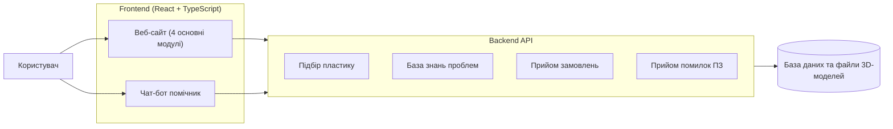
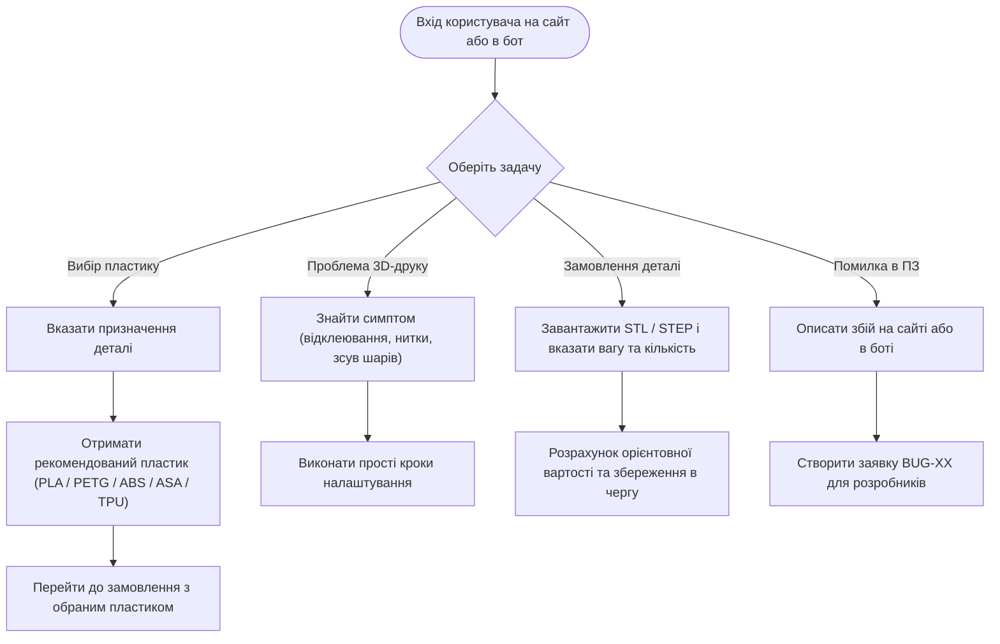
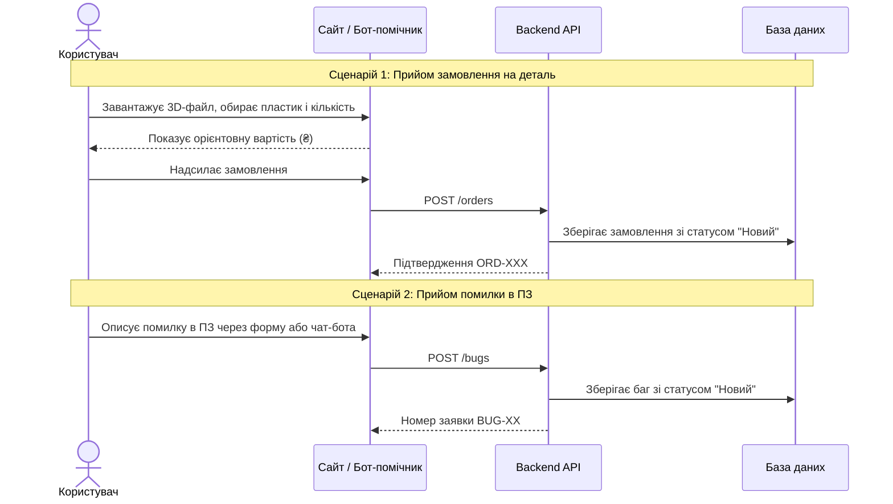
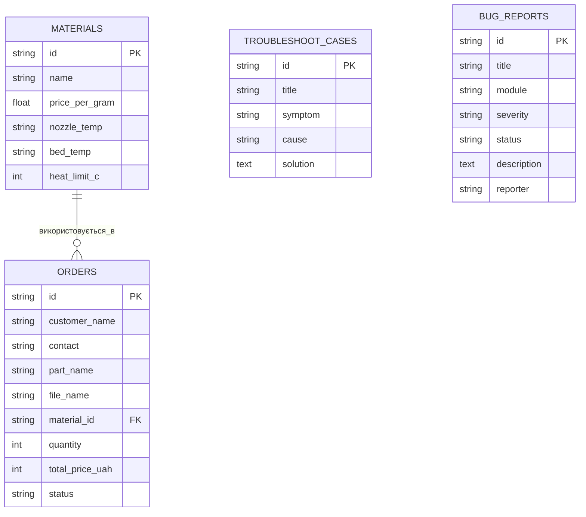

# Діаграми проєкту LayerCore 3D

> Система охоплює 4 основні функції IT-фірми з 3D-друку: **вибір пластику**, **вирішення простих проблем**, **прийом замовлень на деталі** та **прийом помилок в ПЗ** (без надання рецептів кави).

---

## 1. Загальна архітектура системи

---

## 2. Схема основних бізнес-процесів

---

## 3. Діаграма послідовності: замовлення деталі та реєстрація помилки ПЗ

---

## 4. ER-діаграма бази даних

